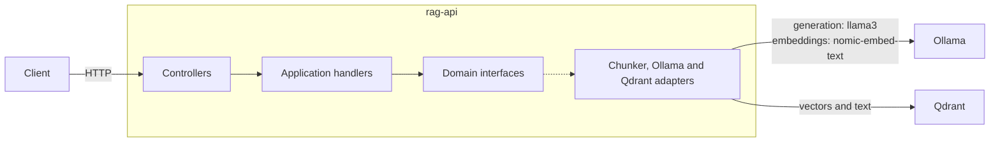

# RAG Service Go

A Retrieval-Augmented Generation (RAG) HTTP service written in Go. It ingests text, stores it as embeddings in [Qdrant](https://qdrant.tech/), and answers questions about it using a local LLM through [Ollama](https://ollama.com/). Nothing leaves your machine, and no API keys are needed.

The service is designed to run locally. It has no authentication or API rate limiting, so don't expose it publicly.

## Features

- Text ingestion: chunking, embedding, and storage in a vector database
- Question answering over ingested text using similarity search
- Health endpoints for the API, Qdrant, and Ollama
- Rate limiting and a circuit breaker on Ollama generation and health calls
- Structured JSON logs, collected in Loki and viewable in Grafana
- Unit tests, plus integration tests against real services, all run in CI

## Quickstart

You need Docker with Compose, and about 6 GB of disk space for the models. Running the tests also requires Go 1.26 or later.

1. Start all services and download the models:
   ```bash
   make local-complete-first-start
   ```

2. Ingest a document:
   ```bash
   curl -i localhost:8080/ingest \
     -H 'Content-Type: application/json' \
     -d '{"text":"The Zorzal project was created in Cuenca by Marta Vidal in 2019.","documentId":"example-1"}'
   ```

3. Ask a question about it:
   ```bash
   curl localhost:8080/generate \
     -H 'Content-Type: application/json' \
     -d '{"prompt":"Who created the Zorzal project, and where?"}'
   ```
   The first answer can take a while, because Ollama has to load the model into memory.

4. Stop everything when you're done. Ingested data and models are kept:
   ```bash
   make docker-stop
   ```

After changing the code, rebuild the API with `make docker-start-build`.

## API

### `POST /ingest`

Splits the text into chunks, embeds them, and stores them in Qdrant.

```json
{
  "text": "Your document text goes here...",
  "documentId": "doc-123"
}
```

`text` is required. `documentId` is optional and defaults to `default-doc`.

Returns `202 Accepted` with an empty body once the text is stored.

### `POST /generate`

Finds the 3 chunks most similar to the prompt and asks the LLM to answer using them. If nothing has been ingested yet, the prompt goes to the LLM without any context.

```json
{
  "prompt": "What is the main topic of the document?"
}
```

Returns `200 OK`:

```json
{
  "response": "The document primarily discusses..."
}
```

`POST /llm/generate` is an alias of this endpoint.

### Health checks

| Endpoint | Checks | Healthy | Unhealthy |
|---|---|---|---|
| `GET /health` | The API itself | `200` with an empty body | No response |
| `GET /db/health` | Qdrant | `200` `{"status":"ok","db":"up"}` | `503` `{"status":"degraded","db":"down"}` |
| `GET /llm/health` | Ollama | `200` `{"status":"ok","llm":"up"}` | `503` `{"status":"degraded","llm":"down"}` |

### Errors

| Status | Cause | Body |
|---|---|---|
| `400` | Invalid JSON or a missing required field | Plain text |
| `405` | Wrong HTTP method | Plain text |
| `500` | Failure while processing the request | `{"error":"..."}` |

## Architecture



The code follows Clean Architecture, with dependencies pointing inward:

| Layer | Path | Contains |
|---|---|---|
| Domain | `internal/domain` | Models and the `LLMClient`, `VectorStore`, and `Chunker` interfaces |
| Application | `internal/application` | One handler per use case |
| Infrastructure | `internal/infrastructure` | HTTP controllers and the Ollama, Qdrant, and chunker adapters |
| Wiring | `cmd` | Entry point, routes, and dependency injection |

### Request flow

- **Ingest:** split the text into 500-character chunks -> embed each chunk -> store the vectors and text in Qdrant. The collection is created on first use.
- **Generate:** embed the prompt -> search Qdrant for the 3 closest chunks -> add them to the prompt as context -> generate the answer with `llama3`.

## Configuration

The API reads these environment variables, and all are required. For Docker, they're set in `docker-compose.yml`.

| Variable | Compose value |
|---|---|
| `OLLAMA_URL` | `http://ollama:11434` |
| `QDRANT_URL` | `http://qdrant:6333` |
| `QDRANT_COLLECTION` | `documents` |

Models, chunk size, the number of retrieved chunks, and the API port (`8080`) are set in the code.

If you switch to an embedding model with a different vector size, delete the existing Qdrant collection first, because its size is fixed when it's created.

## Services

| Service | URL | Purpose |
|---|---|---|
| API | http://localhost:8080 | This service |
| Qdrant | http://localhost:6333 | Vector database |
| Ollama | http://localhost:11434 | Generation and embeddings |
| Grafana | http://localhost:3000 | Log viewer, no login required |
| Loki | http://localhost:3100 | Log storage, fed by Alloy |

To view logs, add a Loki data source in Grafana with the URL `http://loki:3100`, then run `{service_name="rag-api"}` in Explore.

## Testing

| Command | Runs | Requires |
|---|---|---|
| `make test-unit` | Unit tests, using mocks and `httptest` | Go |
| `make test-integration` | Integration tests against real Qdrant and Ollama, with no mocks | Go, Docker, and the downloaded models |
| `make test` | Both | Same as integration |
| `make test-coverage` | Unit tests with a coverage summary | Go |

`make test-integration` and `make test` rebuild and start the Docker stack first, so they always test the current code. The end-to-end test leaves its data in the `documents` collection.

Tests are separated with the `unit` and `integration` Go build tags. GitHub Actions runs linting, the build, and unit tests, then the integration tests with Qdrant and Ollama as service containers.

## Tech stack

- **Language:** Go
- **Vector database:** Qdrant
- **LLM runtime:** Ollama, with `llama3` and `nomic-embed-text`
- **Logging:** zerolog, Alloy, Loki, and Grafana
- **Resilience:** gobreaker and `golang.org/x/time/rate`
- **Testing:** testify and `httptest`

## License

[MIT](LICENSE)
